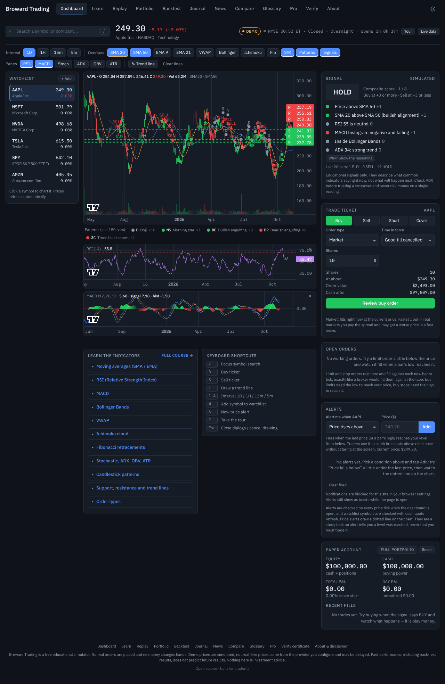
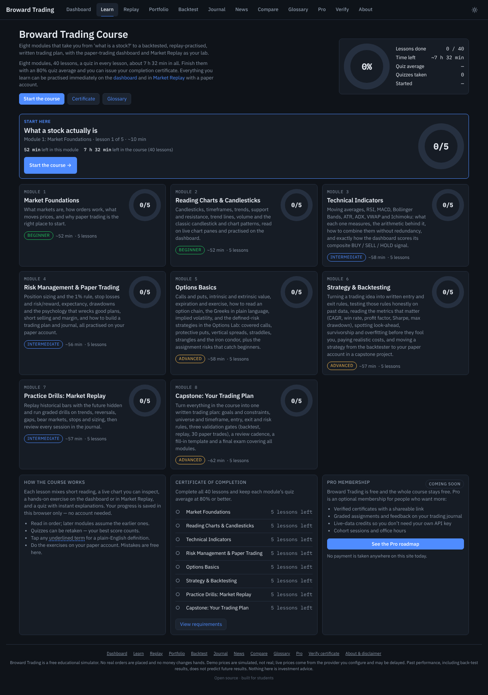
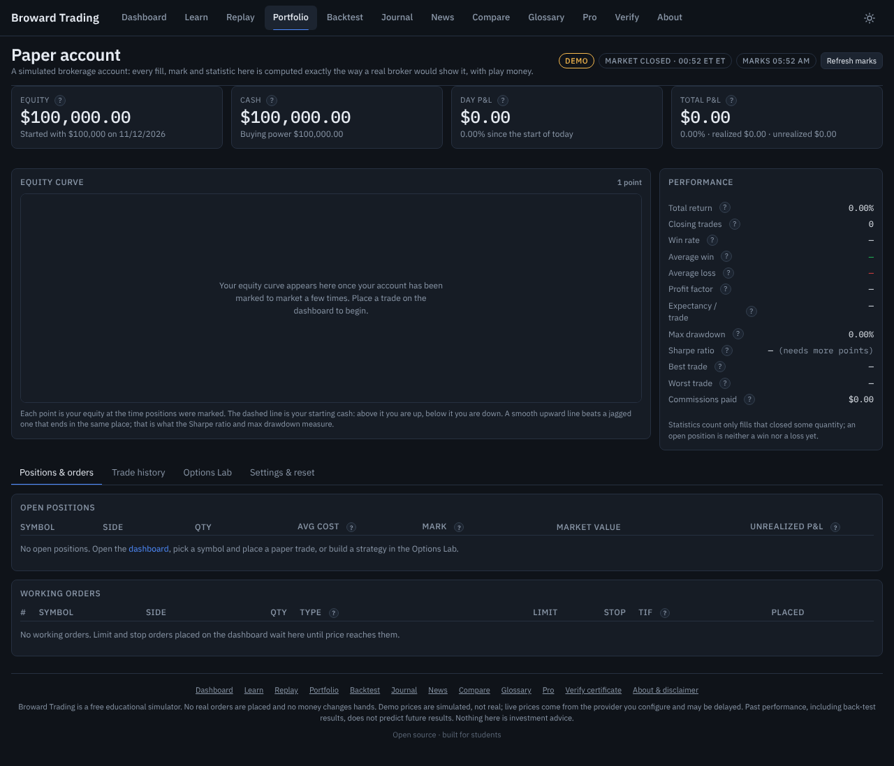
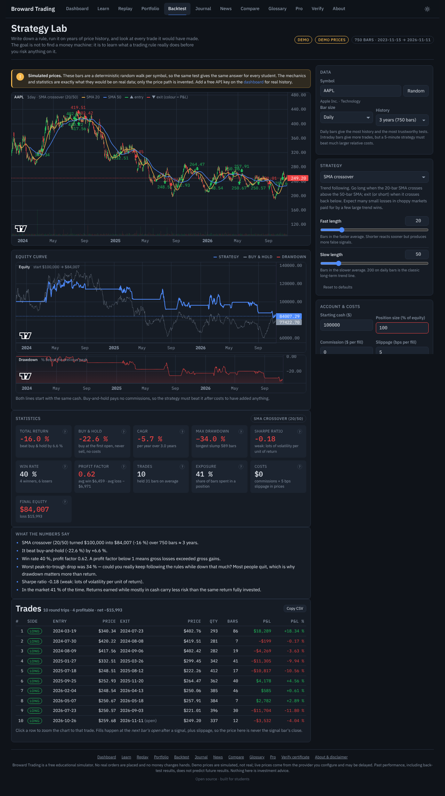
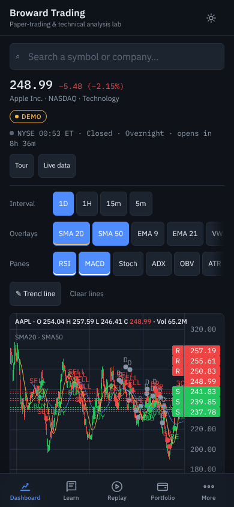
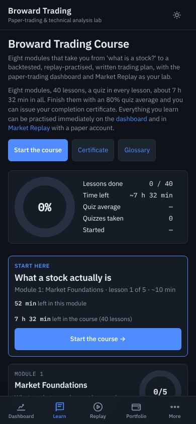
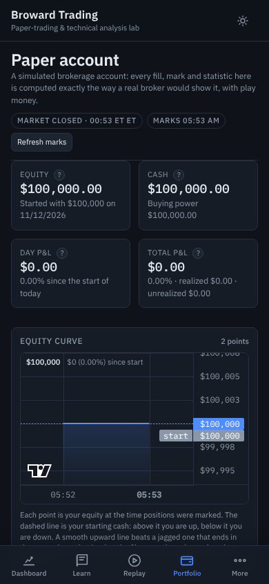
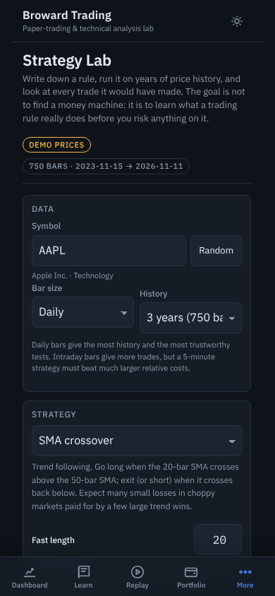

# Broward Trading

**A free, open-source paper-trading and technical-analysis lab with a built-in trading course, Market Replay, a trading journal and an installable phone app.**
Static site, no build step, no accounts required, no money. Open `index.html` and start learning.

> Broward Trading is an educational simulator. No real orders are placed and no money changes hands.
> Demo prices are generated, not real. Nothing here is investment advice. See [Disclaimer](#disclaimer).

---

## Contents

1. [What it is](#what-it-is)
2. [Screenshots](#screenshots)
3. [Features](#features)
4. [Pages](#pages)
5. [Quick start](#quick-start)
6. [Install it on your phone](#install-it-on-your-phone)
7. [Live market data and free-tier limits](#live-market-data-and-free-tier-limits)
8. [Architecture](#architecture)
9. [Course structure](#course-structure)
10. [Teaching with it](#teaching-with-it)
11. [Membership backend (optional)](#membership-backend-optional)
12. [Running the tests](#running-the-tests)
13. [Contributing](#contributing)
14. [Other docs](#other-docs)
15. [Disclaimer](#disclaimer)
16. [License](#license)

---

## What it is

Broward Trading was built for students (first at Broward College, then anyone) who want to learn how
markets, charts, indicators, risk management and options work **by doing**, without risking a dollar.

It is four things in one static website:

| Part | What you get |
|---|---|
| **Simulator** | Candlestick charts, 15+ indicators, a composite BUY / SELL / HOLD signal that explains itself, a paper-trading account with market / limit / stop orders and shorting, price and indicator alerts, a synthetic options chain with Greeks and payoff diagrams, a strategy backtester with parameter optimisation, and a symbol comparison page with correlation and relative strength. |
| **Market Replay** | Trade past data bar by bar with the future hidden. Ten graded drills (trend following, breakouts, range trading, bear-market survival, stop discipline, short selling, intraday) with a scorecard at the end and a separate practice account so your main portfolio stays clean. |
| **Course** | Eight modules (40 lessons) from "what is a stock?" through indicators, risk, options and backtesting to replay drills and a written trading plan. Every lesson links to a live exercise. Quizzes track progress and unlock a certificate. A 220-term glossary with flashcards and a "Daily 5" quiz keeps the vocabulary fresh. |
| **Journal & review** | Every paper trade becomes a journal entry you tag with setup, emotion and confidence; stats by tag show where your edge and your leaks are; a weekly review checklist and export to JSON / CSV. |

Everything (portfolio, journal, course progress, settings) is stored in your browser's `localStorage`. The site works with no server at all. An **optional** Cloudflare Worker adds email sign-in, a Pro tier and server-verified certificates when a site owner chooses to deploy it; see [Membership backend](#membership-backend-optional).

## Screenshots

Captured by the Playwright smoke test (`tests/e2e.playwright.js`) at 1280 px and 390 px, dark theme.

| Dashboard | Course | Portfolio | Backtester |
|---|---|---|---|
|  |  |  |  |
|  |  |  |  |

Screenshots of the v0.3 pages (Replay, Journal, Glossary, News, Compare, Pro, Verify) are added when the e2e script's page list is extended; see `docs/ROADMAP.md`.

## Features

### Dashboard (`index.html`)
- TradingView **lightweight-charts** candlesticks with volume, on daily, 1 h, 15 min, 5 min and 1 min bars. Served from unpkg with a vendored fallback in `js/vendor/` so the chart works when the CDN is blocked or you are offline.
- Overlays: SMA / EMA / WMA, Bollinger Bands, VWAP, Ichimoku cloud, pivots, support / resistance, Fibonacci retracements.
- Oscillator panes: RSI, MACD, Stochastic, ADX / DI, ATR, OBV.
- Automatic **candlestick-pattern detection** (doji, hammer, shooting star, engulfing, morning / evening star, three white soldiers / black crows) with plain-English descriptions.
- A **composite signal** that scores every indicator, shows the points each one contributed and *why*, and states clearly that it describes what indicators say right now, not what will happen next.
- **Alerts panel** (new in v0.3): price above / below, RSI above / below, SMA cross, composite-signal change. Checked on every tick; in-page toast plus a browser `Notification` when you grant permission.
- Market status (pre-market, open, after-hours, closed, US holidays) in New York time.
- Watchlist and symbol search over a 40+ ticker demo universe; live search when a provider key is configured.
- Deep links: `index.html#symbol=NVDA&interval=1h&ov=sma20,bb&pane=rsi` opens exactly that chart; lessons use these for exercises.

### Market Replay (`replay.html`, new in v0.3)
- Pick a symbol, interval and start date. The engine holds every bar but shows only `bars.slice(0, cursor)`; step one bar, play at a chosen speed, pause, or jump to a date. Optional intraday ticks reveal each bar in four sub-steps (open, first extreme, second extreme, close) so stops and limits fill the way they would have inside the bar.
- Trades go through the paper engine on a dedicated **`replay` account**; resting limit / stop orders are processed on every step.
- A visible **hidden-future honesty note**, a **scorecard** at the end (return vs buy-and-hold, trades, win rate, max drawdown, pass / fail against the drill's criteria) and a session history in `bt.replay.sessions`.
- Ten **drills** from `course/drills.json`, each tied to a lesson, with objective, hints and graded criteria. "Practice in Replay" buttons in the course open them directly (`replay.html#drill=<id>`).

### Paper trading (`portfolio.html`)
- $100,000 starting balance (configurable, resettable), cash, positions, open orders, trade log and equity curve.
- Market, limit, stop and stop-limit orders with day / GTC time-in-force; shorting; optional commissions.
- Mark-to-market P&L, realised vs unrealised, day P&L, and statistics: total return, win rate, average win / loss, profit factor, max drawdown, Sharpe.
- **Multiple accounts** (new in v0.3): `main` for the dashboard and portfolio, `replay` for Market Replay; `BT.paper.use(id)` switches, `BT.paper.accounts()` lists them with equity. Storage stays backward compatible.

### Options lab (`portfolio.html`)
- Black-Scholes-Merton pricing and Greeks (delta, gamma, theta, vega, rho) and implied volatility.
- A synthetic option chain around spot with a volatility smile and bid / ask spread, using OCC-style contract ids.
- Payoff diagrams and `analyze()` for nine preset strategies (long call, long put, covered call, protective put, bull call spread, bear put spread, straddle, strangle, iron condor), each with max profit / loss, breakevens and a one-paragraph explanation.

### Strategy lab (`backtest.html`)
- Built-in strategies: SMA cross, RSI mean reversion, MACD cross, Bollinger bounce, breakout, composite signal, buy-and-hold.
- Honest statistics: return vs buy-and-hold, CAGR, win rate, profit factor, max drawdown, Sharpe, exposure, trade count; trades drawn as chart markers.
- Grid optimisation (capped at 200 combinations) with a lesson on why the best backtest is usually overfit.

### Trading journal (`journal.html`, new in v0.3)
- Entries are created automatically from paper and replay fills (keyed by trade id) and can be added by hand.
- Each entry: symbol, date, **setup** (19 presets), **tags**, **emotion** (calm, confident, hesitant, bored, FOMO, anxious, greedy, revenge, tired), **confidence 1-5**, notes, lessons, **rating 1-5**.
- Stats grouped by setup, tag and emotion; a seven-item **weekly review checklist** with "why it matters" for each item and four review questions.
- Export as JSON or CSV text (copy or save; nothing leaves the browser).

### Glossary, flashcards and Daily 5 (`glossary.html`, new in v0.3)
- 220 terms, each with a definition, an example, related terms and a link to the lesson that teaches it. Search and A-Z browsing.
- **Flashcard mode** with light spaced repetition (again / hard / good, persisted in `bt.flashcards`).
- **Daily 5**: five questions a day, deterministic per calendar day, drawn from a 230-question bank built from every module quiz plus new questions; streak tracking.
- Lessons show glossary tooltips wherever the text uses `[[term]]`.

### News and fundamentals (`news.html`, new in v0.3)
- Company profile, key statistics, earnings calendar and headlines via Finnhub, or company overview via Alpha Vantage, using your own key.
- Headlines classified by type (earnings, guidance, analyst, product, legal, deal, macro, insider) and "what moved it?" prompts framed as questions, never claims.
- **Demo mode never fabricates headlines.** Without a key the page shows an explicit "connect a key" state and an educational explainer of earnings, P/E and market cap.

### Compare (`compare.html`, new in v0.3)
- Up to six symbols rebased to 100 on one chart, over selectable periods.
- Correlation matrix (canvas heatmap with values), beta and **relative strength vs SPY**, per-symbol stats (return, volatility, max drawdown, Sharpe).
- Watchlist **heatmap tiles** sized and coloured by % change, with a plain-English diversification note.

### Course (`learn.html`)
- Eight modules, five lessons each, with text, callouts, embedded live charts, exercises that send you to the simulator, drills that send you to Replay, and quizzes.
- Progress tracked per lesson and per quiz; a module progress bar; a **completion certificate** drawn to canvas when every lesson is done and quizzes average 80 % or better.
- Certificates can be verified at `verify.html`. Browser-issued certificates carry an id starting with `BT-YYYY-L…`; server-verified ones (when the optional backend is deployed) carry a signed id and are checked against the server.

### Pro and verification (`pricing.html`, `verify.html`, new in v0.3)
- `pricing.html` states plainly that everything is free today and lists what Pro will add (verified certificate, instructor dashboard and classroom leaderboard, lesson PDFs, priority support). Sign-in and checkout appear only when a site owner has configured the backend in `js/config.js`.
- `verify.html` checks a certificate id, locally for browser-issued ids and against the API for signed ones.
- `proGating` is `false` by default: no lesson is ever locked unless a site owner turns it on *and* marks lessons `pro:true`.

### Phone app (PWA, new in v0.3)
- `manifest.json`, `sw.js` and icons make the site installable on iPhone and Android with an app icon, standalone window and offline app shell. See [docs/MOBILE.md](docs/MOBILE.md).
- On screens up to 760 px wide a **fixed bottom tab bar** shows Dashboard, Learn, Replay, Portfolio and More; "More" opens a sheet with every other page, the theme switch and an Install button when the browser offers one.
- Every page is laid out for 390 px: tap targets at least 44 px, no horizontal scroll, collapsible panels.
- Market data is never cached by the service worker for longer than 60 s (in practice it is never cached at all; `js/data.js` keeps its own short cache).

### Design
- Dark-first, light theme via OS preference or `data-theme` (toggle persisted in `bt.theme`); IBM Plex Sans / Mono; one accent colour; green and red reserved for gain / loss. See `docs/BRAND.md`.
- Keyboard-navigable; no emojis in UI copy; shared nav and footer injected by one module (`js/nav.js`) so every page stays consistent.

## Pages

| Page | What it does | Primary tab on phones |
|---|---|---|
| `index.html` | Dashboard: chart, indicators, signal, alerts, watchlist, trade ticket, data settings | Dashboard |
| `learn.html` | Course player, progress, certificate | Learn |
| `replay.html` | Market Replay and drills | Replay |
| `portfolio.html` | Paper account, orders, options lab | Portfolio |
| `backtest.html` | Strategy lab and optimiser | More |
| `journal.html` | Trading journal, stats, weekly review, export | More |
| `news.html` | Company profile, earnings, headlines (key required) | More |
| `compare.html` | Relative performance, correlation, heatmap, RS vs SPY | More |
| `glossary.html` | Glossary, flashcards, Daily 5 | More |
| `pricing.html` | What is free, what Pro will add, sign-in when configured | More |
| `verify.html` | Certificate verification | More |
| `about.html` | Mission, data sources, disclaimer, roadmap, FAQ | More |

## Quick start

### Option A: just open it
Download or clone this folder and double-click `index.html`. The dashboard, portfolio, options and backtester all work from `file://`.

> Pages that load JSON with `fetch()` (`learn.html`, `replay.html` drills, `glossary.html`) are blocked by most browsers on `file://`, and the service worker only registers over http(s). Use option B for the full site.

### Option B: serve locally (recommended)
Any static file server works. Pick one:

```bash
# Python 3 (preinstalled on macOS / most Linux)
cd broward-trading
python3 -m http.server 8080
# then open http://localhost:8080

# Node
npx serve .          # or: npx http-server -p 8080

# VS Code: install the "Live Server" extension and click "Go Live"
```

### Option C: GitHub Pages (free hosting)
1. Create a repository on GitHub (for example `broward-trading`).
2. From this folder: `git init` (if needed), `git add .`, `git commit -m "Broward Trading v0.3"`, `git remote add origin https://github.com/<you>/broward-trading.git`, `git push -u origin main`.
3. On GitHub: **Settings → Pages → Build and deployment → Source: Deploy from a branch**, branch `main`, folder `/ (root)`, Save.
4. Wait a minute, then open `https://<you>.github.io/broward-trading/`.

The `.nojekyll` file in this repo tells Pages to serve files exactly as they are. GitHub Pages is served over HTTPS, which is what the service worker and "Add to Home Screen" need. Full details, custom domains, service-worker cache busting and troubleshooting are in [docs/DEPLOY.md](docs/DEPLOY.md).

### Turning on live data
Open the dashboard, tap **Data settings**, choose a provider and paste your free API key. The key is stored in your browser only (`localStorage` key `bt.data`) and sent only to that provider, directly from your device. Clear it any time.

## Install it on your phone

Once the site is served over HTTPS (GitHub Pages does this for you):

- **iPhone / iPad (Safari)**: Share button → **Add to Home Screen** → Add.
- **Android (Chrome)**: the three-dot menu → **Install app** (or **Add to Home screen**), or tap **Install app** in the More sheet when Chrome offers it.

You get an icon, a full-screen window without browser chrome, and the app shell and course work offline in demo mode. Step-by-step with troubleshooting, plus tips for using the charts and order ticket on a small screen, are in [docs/MOBILE.md](docs/MOBILE.md).

## Live market data and free-tier limits

Broward Trading never proxies market data through a server of ours; your browser talks to the provider. That keeps the project free to host, but it means **you bring your own key** and the app must respect each provider's free limits. The data layer (`js/data.js`) caches responses and rate-limits requests so a classroom of students does not burn through a key in a minute.

| Provider | Free tier (approximate, verify on their site) | Best for | Notes |
|---|---|---|---|
| **Demo mode** (default) | Unlimited, offline | Learning the tools, classrooms, Replay drills, no sign-up | Deterministic seeded random walk per symbol. Realistic shape, **not real prices**. Ticks every few seconds while the market is "open". Every student sees the same bars, which is what makes drills gradable. |
| **Twelve Data** | 800 requests / day, 8 / minute | History (daily and intraday candles) and US quotes | Recommended for most students. Intraday and daily bars on the free plan; real-time for US stocks. Daily cap is the binding limit: one chart load with indicators is one request. |
| **Finnhub** | 60 requests / minute | Real-time US quotes, symbol search, company profile, news, earnings calendar | Quotes, profiles and news are free; **candles require a paid plan**, so the app pairs Finnhub quotes with Twelve Data or demo history. The News page works best with a Finnhub key. |
| **Alpha Vantage** | 25 requests / day | End-of-day history and company overview when nothing else is available | Very tight daily cap. Intraday is delayed / limited on free. Fine for a daily chart of one or two symbols. |

What "accurate" means for an education tool, delayed vs real-time, consolidated vs single-exchange prices, and paid upgrade paths with rough prices are covered in [docs/DATA_SOURCES.md](docs/DATA_SOURCES.md).

When a key is missing or a request fails (including CORS or network errors), the data layer falls back to demo data and flags the result with `{fallback: true, reason}` so the UI can show a clear "demo" badge instead of pretending. The News page is the one exception: it never falls back to invented content; it shows the "connect a key" state instead.

## Architecture

Plain ES2020 JavaScript, no bundler, no framework, no TypeScript. Every module is a classic `<script>` that attaches to the global namespace `window.BT` and can be loaded standalone (and unit-tested in Node with a `window` shim). The interface of every module is specified in [CONTRACTS.md](CONTRACTS.md); pages and modules are built against that contract, so you can replace one module without touching the others.

```
broward-trading/
├── index.html            Dashboard: chart, indicators, signal, alerts, watchlist, data settings
├── learn.html            Course player, progress, certificate
├── replay.html           Market Replay and drills
├── portfolio.html        Paper account, orders, options lab
├── backtest.html         Strategy lab and optimiser
├── journal.html          Trading journal, stats, weekly review, export
├── news.html             Company profile, earnings, headlines (key required)
├── compare.html          Relative performance, correlation, heatmap, RS vs SPY
├── glossary.html         Glossary, flashcards, Daily 5
├── pricing.html          Free vs Pro, sign-in and checkout when the backend is configured
├── verify.html           Certificate verification
├── about.html            Mission, disclaimer, roadmap, FAQ
├── manifest.json         PWA manifest (name, colours, icons, shortcuts)
├── sw.js                 Service worker: precached app shell, never caches market data
├── icons/                icon.svg, icon-192.png, icon-512.png
├── css/style.css         Shared design tokens and components (see docs/BRAND.md)
├── js/
│   ├── nav.js            BT.nav       the ONLY place nav, tab bar, footer, theme, manifest + SW registration live
│   ├── config.js         BT.config    site owner settings: apiBase, proGating (public, no secrets)
│   ├── indicators.js     BT.ind       pure indicator math, patterns, composite signal
│   ├── data.js           BT.data      providers, cache, rate limits, demo generator, market hours
│   ├── paper.js          BT.paper     portfolio engine, multiple accounts, orders, mark-to-market, stats
│   ├── options.js        BT.options   Black-Scholes, IV, synthetic chain, payoffs, strategies
│   ├── backtest.js       BT.backtest  strategies, runner, statistics, optimiser
│   ├── course.js         BT.course    lesson loader, markdown subset, progress, certificate
│   ├── replay.js         BT.replay    hidden-future replay engine, drills, scorecard, sessions
│   ├── alerts.js         BT.alerts    alert definitions, evaluation, notifications
│   ├── journal.js        BT.journal   entries, auto-sync from fills, stats, review, export
│   ├── glossary.js       BT.glossary  terms, search, flashcards, Daily 5
│   ├── news.js           BT.news      Finnhub / Alpha Vantage adapters, classification, explainers
│   ├── compare.js        BT.compare   align, rebase, correlation, beta, RS, heatmap maths
│   ├── auth.js           BT.auth      membership client; works offline when apiBase is ''
│   ├── app.js            dashboard UI (index.html)
│   ├── learn.js          course UI (learn.html)
│   ├── portfolio.js      portfolio + options UI (portfolio.html)
│   ├── backtest-ui.js    strategy lab UI (backtest.html)
│   └── vendor/           lightweight-charts 4.2.0 fallback + its licence
├── course/
│   ├── index.json        module and lesson index (8 modules)
│   ├── m1-…m8-*.json     one file per module with lesson blocks and quizzes
│   ├── drills.json       Market Replay drills
│   ├── glossary.json     220 terms
│   └── questionbank.json 230 questions for Daily 5
├── server/               optional Cloudflare Worker (worker.js, wrangler.toml, README.md)
├── tests/                node tests/<module>.test.js, plain assert, no framework; e2e.playwright.js
├── docs/                 BRAND, ROADMAP, CHANGELOG, DATA_SOURCES, BUSINESS, DEPLOY, MOBILE,
│                         TEACHING_GUIDE, MEMBERSHIP_SETUP, screenshots/
├── CONTRACTS.md          the module interfaces everything is built against
├── .nojekyll             tells GitHub Pages to serve files verbatim
└── LICENSE               MIT
```

### Module summary

| Module | Namespace | Responsibility |
|---|---|---|
| `js/nav.js` | `BT.nav` | Injects top nav, phone tab bar and "More" sheet, theme toggle (`bt.theme`), disclaimer footer, manifest link, service-worker registration. Pages contain only `<div id="nav"></div>` and `<div id="footer"></div>`. |
| `js/indicators.js` | `BT.ind` | SMA / EMA / WMA, RSI, MACD, Bollinger, ATR, ADX, Stochastic, VWAP, OBV, Ichimoku, pivots, support / resistance, Fibonacci, candle patterns, `signals()` composite scoring, `computeAll()`. Pure functions; `null` where undefined. |
| `js/data.js` | `BT.data` | `providers.{demo,twelvedata,finnhub,alphavantage}` each with `candles`, `quote`, `search`; settings in `bt.data`; cache (60 s intraday / 10 min daily / 15 s quotes); per-provider rate limiter; demo random walk and `demoTick`; `marketStatus()` with NYSE hours and US holidays. |
| `js/paper.js` | `BT.paper` | `use(accountId)` / `accounts()`; state in `bt.portfolio` (main) and `bt.portfolio.<id>`; `placeOrder`, `processOrders`, `markToMarket`, `closePosition`, `cancelOrder`, option positions by OCC id, `stats()`. |
| `js/options.js` | `BT.options` | `bs()`, `impliedVol()`, `chain()`, `payoff()`, `analyze()`, strategy presets, `occ()` / `parseOcc()`. |
| `js/backtest.js` | `BT.backtest` | Strategy objects with `onBar(ctx, i)`, built-ins, `run()` with cash / sizing / commission / slippage / shorting, `optimize()`. |
| `js/course.js` | `BT.course` | Loads `course/*.json`, `renderMd()` (escape first, then markdown), progress in `bt.course`, `certificateEligible()`, `certificate({name})` to canvas. |
| `js/replay.js` | `BT.replay` | `step()`, `play(speed)`, `pause()`, `jumpTo(date)`, tick sub-steps, trades on the `replay` account, scorecard, drills from `course/drills.json`, sessions in `bt.replay.sessions`, save-to-journal. |
| `js/alerts.js` | `BT.alerts` | `add()`, `list()`, `remove()`, `check(symbol, bars, ind)`; persisted `bt.alerts`; toast + `Notification`. Fires on the transition into the condition. |
| `js/journal.js` | `BT.journal` | Entries in `bt.journal`, `sync()` from every paper account, stats by setup / tag / emotion, weekly review checklist and questions, `exportJSON()` / `exportCSV()`. |
| `js/glossary.js` | `BT.glossary` | `load()`, `search()`, `get()`, `linkify()`; `flashcards.*` in `bt.flashcards`; `daily.*` in `bt.daily5`. |
| `js/news.js` | `BT.news` | `source()`, `load(symbol)`, normalisers for Finnhub and Alpha Vantage, `classifyHeadline()`, `whatMovedIt()`, explainers; cache in `bt.news.cache`. |
| `js/compare.js` | `BT.compare` | `align()`, `rebase()`, `returns()`, `pearson()`, `correlationMatrix()`, `beta()`, `relativeStrength()`, `stats()`, `heat()`, `drawMatrix()`. |
| `js/auth.js` | `BT.auth` | `signIn(email)`, `session()`, `isPro()`, `signOut()`, `checkout(plan)`, `issueCertificate({name})`, `verify(id)`, `leaderboard()` / `submitScore()`; fully functional in local-only mode when `apiBase` is empty. |

Bars everywhere are `{time, open, high, low, close, volume}`, oldest to newest; `time` is `'YYYY-MM-DD'` for daily and unix seconds for intraday. Charts use lightweight-charts v4.2.0 from unpkg with the vendored copy as fallback.

### Browser storage keys

`bt.data`, `bt.portfolio`, `bt.portfolio.replay`, `bt.course`, `bt.cert`, `bt.theme`, `bt.alerts`, `bt.journal`, `bt.replay.sessions`, `bt.flashcards`, `bt.daily5`, `bt.news.cache`, `bt.auth`, `bt.auth.certs`, plus dashboard preferences (`bt.sym`, `bt.tf`, `bt.ov`, `bt.panes`, `bt.watchlist`, `bt.lines`). Clearing site data resets all of them; the journal and portfolio can be exported first.

## Course structure

Eight modules, roughly 7.5 hours of reading plus exercises and drills. Each lesson ends with a quiz; the certificate unlocks when every lesson is marked done and quiz scores average 80 % or better.

| # | Module | Level | Minutes | Covers |
|---|---|---|---|---|
| 1 | Market Foundations | Beginner | 52 | What a stock is, exchanges and hours, bid / ask / spread, order types, brokers and paper trading |
| 2 | Reading Charts & Candlesticks | Beginner | 52 | Candlesticks and timeframes, trend, support / resistance, trend lines and volume, candle patterns, chart patterns |
| 3 | Technical Indicators | Intermediate | 58 | Moving averages, RSI and stochastic, MACD / Bollinger / ATR, ADX / VWAP / Ichimoku, the composite signal |
| 4 | Risk Management & Paper Trading | Intermediate | 56 | Position sizing and the 1 % rule, stops and expectancy, drawdowns and psychology, shorting and margin, the plan and the journal |
| 5 | Options Basics | Advanced | 58 | Calls and puts, the chain, Greeks and IV, covered calls / protective puts / verticals, straddles / strangles / condors |
| 6 | Strategy & Backtesting | Advanced | 57 | Entry and exit rules, backtest metrics, why backtests lie, costs, build and paper-trade your own strategy |
| 7 | Practice Drills: Market Replay | Intermediate | 57 | Using Replay honestly, trend drills, reversal and range drills, risk drills, self-review with scorecard and journal |
| 8 | Capstone: Your Trading Plan | Advanced | 60 | Why a written plan, defining your edge, risk architecture, proving the plan, the routine and graduation checklist |

Lessons are JSON (`course/<module>.json`) made of blocks: `text`, `callout`, `chart` (a live chart with overlays), `exercise` (a task plus a deep link into the simulator), `drill` (a "Practice in Replay" button for a `drillId`) and `quiz`. `[[term]]` in any text becomes a glossary tooltip. Adding a lesson is editing a JSON file; no code changes needed. The course is free and will stay free; see [docs/BUSINESS.md](docs/BUSINESS.md) for how a paid, verified certificate sits on top of it.

## Teaching with it

[docs/TEACHING_GUIDE.md](docs/TEACHING_GUIDE.md) is a ready-to-run **six-week syllabus** for a college elective built on the app: weekly lessons mapped to modules, in-class exercises with the exact deep links, Replay drills with pass criteria, journal assignments, a grading rubric and how the certificate fits. It assumes students are on phones and the instructor has no budget.

## Membership backend (optional)

Everything above runs with no server. If you want email sign-in, a paid Pro tier, server-verified certificates and an opt-in classroom leaderboard, the repo includes a single **Cloudflare Worker** (`server/worker.js`) with KV storage, Stripe Checkout and Resend email, all on free tiers, with no npm dependencies and no secrets in code.

- Technical reference, routes, KV layout and local development: [server/README.md](server/README.md).
- Step-by-step setup for a non-developer (about 90 minutes): [docs/MEMBERSHIP_SETUP.md](docs/MEMBERSHIP_SETUP.md).
- Business rationale and pricing: [docs/BUSINESS.md](docs/BUSINESS.md).

To connect the site to a deployed Worker, set `apiBase` in `js/config.js` to the Worker URL. That file is public and contains no secrets; `proGating` stays `false` unless you deliberately decide to gate Pro-only lessons. With `apiBase` empty, `pricing.html` explains that the backend is not set up, and `verify.html` still verifies browser-issued certificates.

## Running the tests

The pure modules have Node tests that need nothing but Node 18+ (`tests/auth.test.js` needs Node 22+ for global WebCrypto):

```bash
# run every unit test file
for t in tests/*.test.js; do echo "== $t"; node "$t" || exit 1; done

# or one at a time
node tests/indicators.test.js
node tests/paper.test.js
node tests/replay.test.js
node tests/journal.test.js

# syntax check everything
for f in js/*.js tests/*.js sw.js server/worker.js; do node --check "$f"; done

# validate course JSON
for f in course/*.json manifest.json; do node -e "JSON.parse(require('fs').readFileSync('$f','utf8'))" || echo "BAD JSON: $f"; done
```

As of v0.3 the twelve unit-test files hold 355 assertions-as-tests (alerts, auth, backtest, compare, glossary, indicators, journal, nav, news, options, paper, replay).

End-to-end smoke test (opens every page at desktop and phone widths, places a paper trade, saves screenshots to `docs/screenshots/`): serve the site, then `node tests/e2e.playwright.js`. Needs the `playwright` npm package with Chromium installed; it is not part of the unit tests.

## Contributing

Contributions are welcome: lessons, drills, glossary terms, indicators, strategies, translations, accessibility fixes, bug reports.

1. Read [CONTRACTS.md](CONTRACTS.md) and [docs/BRAND.md](docs/BRAND.md) first. Modules must keep their contract; pages must use the shared tokens and must not contain their own nav or footer markup (that lives in `js/nav.js`).
2. Keep it plain: ES2020, no imports, no frameworks, no build step. Attach to `window.BT`.
3. Design for a 390 px phone first: tap targets at least 44 px, no horizontal scroll, panels collapsible.
4. Educational copy: plain English, second person, explain the *why* next to every number, never promise profits, never call anything "advice". Label simulated data as demo. Never fabricate news or prices.
5. Run the tests and `node --check` before opening a pull request. If you change a precached file in a way users must get immediately, bump `VERSION` in `sw.js`.
6. Open an issue before a large change so we can agree on the contract first.

Course content contributions should include sources for any factual claim and should not include real-money trade recommendations.

## Other docs

- [docs/CHANGELOG.md](docs/CHANGELOG.md): what changed in each release.
- [docs/ROADMAP.md](docs/ROADMAP.md): what is done, what is next, what we will not build.
- [docs/TEACHING_GUIDE.md](docs/TEACHING_GUIDE.md): six-week syllabus, exercises, drills, rubric, certificate.
- [docs/MOBILE.md](docs/MOBILE.md): installing as a PWA on iPhone / Android, phone tips.
- [docs/DATA_SOURCES.md](docs/DATA_SOURCES.md): market-data options, accuracy, costs, recommendation.
- [docs/BUSINESS.md](docs/BUSINESS.md): turning the course into a membership with verified certificates while the simulator stays free.
- [docs/MEMBERSHIP_SETUP.md](docs/MEMBERSHIP_SETUP.md) and [server/README.md](server/README.md): the optional backend.
- [docs/DEPLOY.md](docs/DEPLOY.md): GitHub Pages, custom domains, service worker, publishing from this folder.
- [docs/BRAND.md](docs/BRAND.md): visual system and component catalogue.
- [CONTRACTS.md](CONTRACTS.md): module interfaces.

## Disclaimer

Broward Trading is a free educational simulator. **No real orders are placed and no money changes hands.** Demo prices are generated by a seeded random walk and are not real market prices; a year in a Replay drill title is a scenario label, not the real market of that year. Live prices come from the third-party provider you configure with your own key and may be delayed, incomplete or wrong. Indicators, the composite signal, alerts and backtests describe what a formula says about past prices; they do not predict the future. Nothing on this site is investment, legal or tax advice, and nothing is a recommendation to buy or sell any security. Trading real money involves risk, including the loss of your entire investment. Past performance, simulated or real, does not guarantee future results.

Broward Trading is an independent project and is not affiliated with, endorsed by or sponsored by Broward College or any broker, exchange or data provider.

## License

MIT. Copyright 2026 Broward Trading contributors. See [LICENSE](LICENSE).

Course text, lesson JSON, drills and glossary are also MIT-licensed so teachers can adapt them. Third-party components keep their own licences: TradingView lightweight-charts (Apache-2.0, licence file in `js/vendor/`), IBM Plex fonts (OFL-1.1). Market data belongs to its provider and is subject to their terms.
